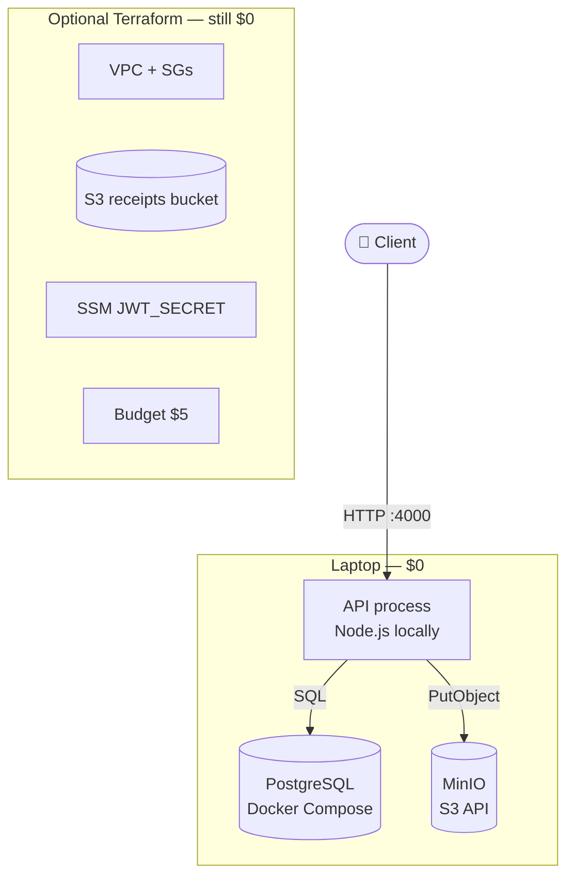
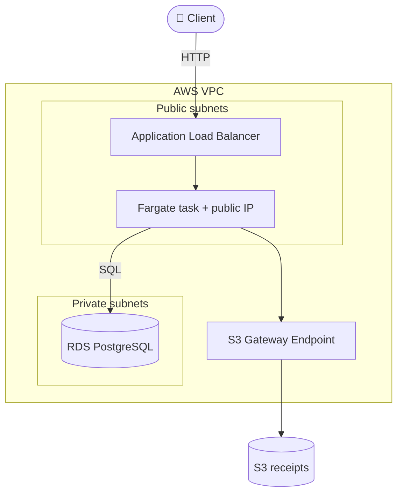
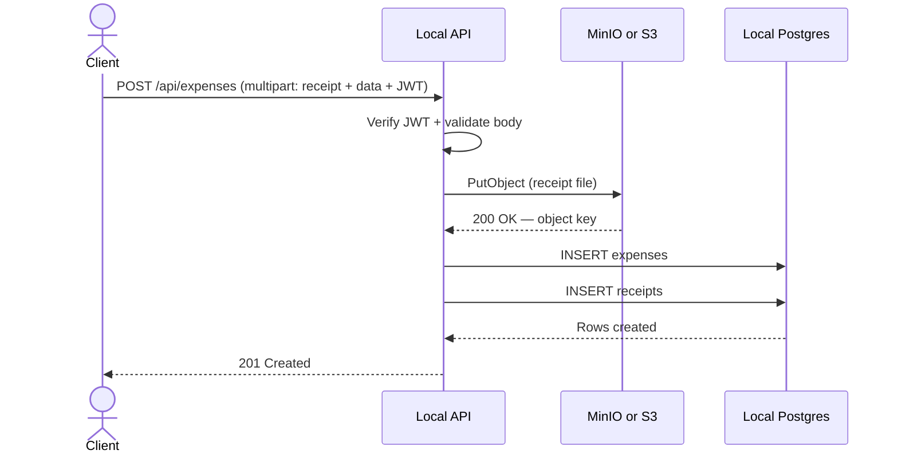
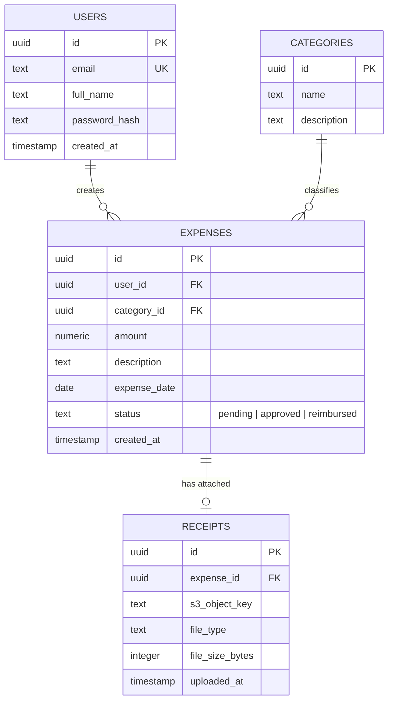

<div align="center">

# ☁️ CloudLedger

### Expense Tracking API — free local build, optional AWS

*A containerized expense API you can run locally for $0. AWS is optional and defaults to always-free resources — ALB, Fargate, and RDS stay off unless you opt in.*

[](#)
[](#)
[](#)
[](#)
[](#)
[](#)
[](#license)

</div>

---

## 🧭 Table of Contents

- [🔍 Overview](#-overview)
- [📌 Project Status](#-project-status)
- [✨ Key Features](#-key-features)
- [🎨 UI Design System](#-ui-design-system)
- [💰 Cost \& Free Tier](#-cost--free-tier)
- [🏗️ System Architecture](#️-system-architecture)
- [🔄 Request Flow](#-request-flow)
- [🗃️ Database Schema (ERD)](#️-database-schema-erd)
- [🔑 IAM \& Security Model](#-iam--security-model)
- [📈 Autoscaling Behavior](#-autoscaling-behavior)
- [🧰 Tech Stack](#-tech-stack)
- [📁 Project Structure](#-project-structure)
- [📡 API Reference](#-api-reference)
- [🚀 Getting Started](#-getting-started)
- [🔐 Environment Variables](#-environment-variables)
- [☁️ Deployment](#️-deployment)
- [🗺️ Roadmap](#️-roadmap)
- [📄 License](#-license)

---

## 🔍 Overview

**CloudLedger** is a backend REST API for tracking expenses. The **MVP runs on your machine** (Node.js + Docker Compose Postgres + MinIO). Terraform can create a **$0 AWS lab** (VPC, S3, IAM, SSM, budget). The resume-shaped stack (ECS Fargate + ALB + RDS) exists in Terraform but is **opt-in** and will bill.

> **Built for:** a free local/cloud-engineer lab first. Do not apply ALB, Fargate, or RDS unless you are ready to pay (or burn credits) and tear them down the same day.

---

## 📌 Project Status

This README is the **target architecture** (what the finished project looks like). Build progress lives in [`TODO.md`](./TODO.md). Do not treat unchecked TODO items as already deployed.

**MVP (free — this is the first build):**

- Auth (`register` / `login`) + expense CRUD + category list
- Receipt upload **through the API** (`POST /api/expenses` multipart → S3 `PutObject`, or MinIO locally)
- Local Postgres + MinIO via Docker Compose
- Terraform **free stack**: VPC, S3 (block public + lifecycle), S3 gateway endpoint, IAM receipts policy, SSM `JWT_SECRET`, $5 budget
- `enable_paid_stack = false` (default)

**Paid opt-in (not part of the free build — `enable_paid_stack = true`):**

- ECS Fargate + ALB + ECR + single-AZ RDS
- CPU target-tracking autoscaling
- CloudWatch **logs** for the tasks

**Post-MVP (roadmap only):**

- Pre-signed S3 upload URLs
- Multi-AZ RDS
- CloudWatch dashboards + alarms
- WAF / rate limiting
- Blue/green deploys
- Secrets Manager
- Private ECS tasks + NAT Gateway

---

## ✨ Key Features

| Feature | Description |
|---|---|
| 🐳 **Containerized API** | Node.js/TypeScript REST API with a multi-stage Dockerfile; run with Compose or `npm run dev` |
| 🗄️ **Local database** | PostgreSQL in Docker for the free build (RDS only if you opt into the paid stack) |
| 📎 **File uploads** | Client sends the receipt with the expense; the API stores it in MinIO locally or S3 |
| 🔐 **Least-privilege IAM** | Receipts policy scoped to `s3:…` on `receipts/*`; ECS roles exist only on the paid stack |
| 🔑 **Secrets** | `.env` locally; SSM Parameter Store if you apply Terraform |
| 💰 **$0 default** | No NAT, no ALB, no Fargate, no RDS unless `enable_paid_stack = true` |

---

## 🎨 UI Design System

Local demo UI lives in [`public/index.html`](./public/index.html) (served at **http://localhost:4000** when the API is running). Atmosphere is a cool concrete ledger — fog blue paper, steel ink, and teal signal accents (not cream/terracotta).

| Token | Value | Use |
|---|---|---|
| `--kraft` | `#d9e3ec` | Page ground |
| `--paper` | `#f3f7fa` | Panels / surfaces |
| `--ink` | `#15202b` | Body text |
| `--steel` | `#1c3344` | Header, primary actions |
| `--copper` | `#0f8f86` | Teal accent underline / links |
| `--ok` | `#1f8a5a` | Success |
| `--err` | `#c44536` | Errors / delete |
| `--line` | `#c5d2de` | Borders / rules |

**Fonts:** [Space Grotesk](https://fonts.google.com/specimen/Space+Grotesk) (brand + UI) and [IBM Plex Mono](https://fonts.google.com/specimen/IBM+Plex+Mono) (amounts, dates, receipt strip).

**Layout notes:** brand-first steel header with CloudLedger wordmark; auth as a composed panel; expense create as a dense toolbar; monthly summary as a serrated thermal-receipt strip; dense expense table with mono amounts. Motion is CSS-only (app fade-in, header underline grow, button press scale, row hover slide).

**Live URL:** https://cloudledger-coral.vercel.app

---

## 💰 Cost & Free Tier

**The free build is $0.** Run the API on your laptop. Docker Compose provides Postgres and MinIO. Do not create ALB, Fargate, RDS, NAT, or Secrets Manager.

### Free path (MVP)

| Resource | Cost | Notes |
|---|---|---|
| Node API + Docker Compose (Postgres, MinIO) | $0 | This is the whole working product |
| IAM, VPC, security groups | $0 | Always free |
| S3 gateway VPC endpoint | $0 | Optional Terraform |
| SSM Parameter Store (Standard, SecureString) | $0 | Optional Terraform |
| S3 (tiny receipt volume) | $0 / pennies | Optional; MinIO covers local |
| AWS Budget email alarm | $0 | Create this before any `apply` |

Default Terraform (`enable_paid_stack = false`) only creates the $0 AWS pieces. Budget default is **$5**.

### Paid path (opt-in only)

Set `enable_paid_stack = true` only for a short demo, then `terraform apply -var enable_paid_stack=false` or `destroy`. These bill **while they exist**, not only while you use them:

| Resource | Why it costs | Rule |
|---|---|---|
| **NAT Gateway** | ~$32–33/month | Never create. Not in this repo. |
| **ALB** | ~$16–22/month | Paid flag only. Destroy when idle. |
| **ECS Fargate** | ~$8–12/month for one 24/7 task | Paid flag only. |
| **RDS** | ~$12/month if not covered by credits | Paid flag only. |
| **Secrets Manager** | $0.40/secret/month | Not used. SSM instead. |
| **Interface VPC endpoints** | ~$7/month each | Skip. |

Leave NAT + ALB + Fargate + RDS up all month and expect **roughly $40–70 USD**.

### Account-plan caveat

AWS Free Tier changed on **15 July 2025**:

- **New accounts** get up to **$200 in credits** (and a Free plan that can block ECS/ALB/RDS). Do not rely on credits for the MVP.
- **Older accounts** may still have 12-month micro allowances. Fargate and NAT Gateway still are not free.

Credits expire. The free build does not need them.

---

## 🏗️ System Architecture

**Free MVP:** the API runs on your machine. Postgres and an S3-compatible store (MinIO) run in Docker Compose. Optional Terraform creates a $0 AWS skeleton (VPC, private S3, IAM, SSM, budget).



**Paid opt-in** (`enable_paid_stack = true`): ECS Fargate behind an ALB, RDS in private subnets, no NAT Gateway. Do not apply this for the free build.



---

## 🔄 Request Flow

Path of a single “create expense + attach receipt” request on the **free MVP**:



Pre-signed direct-to-S3 uploads are **not** in MVP. They are on the [roadmap](#️-roadmap).

---

## 🗃️ Database Schema (ERD)



Indexes (MVP): `expenses(user_id)`, `expenses(category_id)`, `expenses(expense_date)`.

Categories are **seeded** — there is no `POST /api/categories` in MVP.

---

## 🔑 IAM & Security Model

The **free build** does not need AWS credentials. MinIO uses the keys in `.env.example`.

If you apply Terraform, a managed policy allows `s3:PutObject` / `GetObject` / `DeleteObject` on `receipts/*` only. ECS task roles are created only when `enable_paid_stack = true`. RDS (paid) is reached with a password from SSM plus security groups, not IAM database auth.

See [`docs/IAM.md`](./docs/IAM.md).

---

## 📈 Autoscaling Behavior

Not in the free build. CPU target-tracking (`min=1`, `max=3`) is Terraform on the paid ECS service only.

---

## 🧰 Tech Stack

| Layer | Technology | Purpose |
|---|---|---|
| **Language** | TypeScript | Type-safe API |
| **Runtime** | Node.js | REST API server |
| **API validation** | Zod | Request schemas |
| **Auth** | JWT | Register / login / bearer tokens |
| **Database (free)** | PostgreSQL in Docker Compose | Relational storage |
| **File storage (free)** | MinIO (S3 API) | Receipt objects |
| **Secrets (free)** | `.env` | Local only |
| **IaC** | Terraform | Free stack by default; paid stack opt-in |
| **Database (paid)** | RDS PostgreSQL | Opt-in |
| **Compute (paid)** | ECS Fargate + ALB | Opt-in |
| **File storage (paid)** | Amazon S3 | Opt-in |

---

## 📁 Project Structure

```
cloudledger-api/
├── src/
│   ├── controllers/
│   ├── services/
│   ├── middleware/           # JWT auth, Zod validation, errors
│   ├── db/
│   │   ├── migrations/
│   │   └── models/
│   ├── aws/
│   │   ├── s3.ts             # PutObject / GetObject helpers
│   │   └── clients.ts
│   └── routes/
├── tests/
├── infra/
│   ├── terraform/            # Default: VPC, S3, IAM, SSM, budget. Paid: ALB/ECS/RDS behind a flag
│   ├── ecs-task-def.json
│   └── iam-policies/
├── .github/workflows/        # PR lint/typecheck/build; deploy on main
├── Dockerfile
├── .env.example
├── package.json
├── TODO.md
└── README.md
```

---

## 📡 API Reference

Base URL: `/api`

| Method | Endpoint | Auth | Description |
|---|---|---|---|
| `POST` | `/api/auth/register` | No | Create a user |
| `POST` | `/api/auth/login` | No | Return a JWT |
| `GET` | `/api/expenses` | Yes | List expenses (filter by date, category, status) |
| `POST` | `/api/expenses` | Yes | Create an expense; optional multipart receipt → S3 |
| `GET` | `/api/expenses/:id` | Yes | Get one expense and its receipt metadata |
| `PATCH` | `/api/expenses/:id` | Yes | Update status (`pending` / `approved` / `reimbursed`) |
| `DELETE` | `/api/expenses/:id` | Yes | Delete an expense and its receipt object |
| `GET` | `/api/categories` | Yes | List seeded categories |

There is **no** `POST /api/receipts/upload-url` in MVP.

**Example** — `GET /api/expenses/:id`

```json
{
  "id": "e1a2b3c4-...",
  "amount": 128.50,
  "category": "Travel",
  "description": "Client dinner - NYC",
  "expenseDate": "2026-07-10",
  "status": "approved",
  "receipt": {
    "s3ObjectKey": "receipts/e1a2b3c4/invoice.pdf",
    "fileType": "application/pdf",
    "fileSizeBytes": 20480
  }
}
```

---

## 🚀 Getting Started

### Prerequisites

- Node.js ≥ 18
- Docker (for local Postgres + MinIO)
- AWS CLI + Terraform **only if** you apply the optional AWS stack
- A billing alarm before any `terraform apply`

You do **not** need an AWS paid plan, ECS, ALB, or RDS for the MVP.

### Local Development (demo)

```bash
git clone https://github.com/Pmvita/CloudLedger.git
cd CloudLedger
docker compose up -d
cp .env.example .env
npm install
npm run db:migrate
npm run db:seed
npm run dev
```

Open **http://localhost:4000** — Express serves `public/index.html` next to the API. Seeded login: `demo@cloudledger.dev` / `Password123!`.

Keep `S3_ENDPOINT` pointed at MinIO. Do not set real AWS keys for the free build.

### Manual QA checklist

1. Register a new user (or log in with the seeded demo account).
2. Create an expense with an optional PDF/JPEG/PNG receipt.
3. Confirm it appears in the expenses table.
4. Change status via the row dropdown (`pending` → `approved` → `reimbursed`) — `PATCH /api/expenses/:id`.
5. Pick another month in Summary and confirm empty vs populated states.
6. Download a receipt link, then delete the expense.
7. Log out; confirm the sign-in card returns.

Automated coverage: `npm test` (unit + integration against local Postgres when `DATABASE_URL` is set). On Windows, if the clone path contains `)` (for example under `Projects\2) Cloud Engineering\...`), the test script creates a short junction at `%USERPROFILE%\cl` so Vitest workers do not hang.

### Build & Run via Docker

```bash
docker build -t cloudledger-api .
docker run -p 4000:4000 --env-file .env cloudledger-api
```

---

## 🔐 Environment Variables

| Variable | Local (free) | Paid AWS |
|---|---|---|
| `DATABASE_URL` | `.env` → Compose Postgres | SSM `/cloudledger/DATABASE_URL` |
| `JWT_SECRET` | `.env` | SSM `/cloudledger/JWT_SECRET` |
| `AWS_REGION` | `.env` | Task environment |
| `S3_BUCKET_NAME` | `.env` (MinIO bucket name) | Task environment |
| `S3_ENDPOINT` | `http://localhost:9000` | unset (real S3) |
| `PORT` | `.env` (default `4000`) | Task environment |

On the paid stack, AWS access keys are **not** passed into the container. The task role supplies temporary credentials.

---

## ☁️ Deployment

**Free build:** there is nothing to deploy to AWS. `npm run dev` is the product.

**Optional $0 Terraform** (`enable_paid_stack = false`, the default):

1. Copy `infra/terraform/terraform.tfvars.example` to `terraform.tfvars` and set `budget_email`.
2. Confirm `enable_paid_stack = false`.
3. `terraform apply` creates VPC, S3, IAM receipts policy, SSM `JWT_SECRET`, S3 gateway endpoint, and a $5 budget.

**Paid stack** (will bill — not the free build):

1. Set `enable_paid_stack = true` only after a budget alarm exists.
2. `terraform apply` then creates ALB, ECS Fargate, ECR, and RDS.
3. Build and push the image to ECR, then rolling ECS deploy.
4. Same day: set the flag back to `false` or `terraform destroy`. Snapshot RDS first if you need the data.

---

## 🗺️ Roadmap

Do not start these for the free MVP.

- [ ] Opt-in paid demo: ALB + Fargate + RDS (`enable_paid_stack = true`) for a few hours, then destroy
- [ ] Pre-signed S3 upload URLs (client → S3, API only stores the key)
- [ ] Multi-AZ RDS
- [ ] CloudWatch dashboards + alarms (latency, 5xx, unhealthy tasks)
- [ ] API rate limiting via ALB / WAF
- [ ] Blue/green deployment
- [ ] Move secrets from SSM to Secrets Manager
- [ ] Private ECS tasks + NAT Gateway (production networking)

---

## 📄 License

Distributed under the MIT License. See [`LICENSE`](./LICENSE) for more information.

IAM role split: [`docs/IAM.md`](./docs/IAM.md). OpenAPI: [`docs/openapi.yaml`](./docs/openapi.yaml). How to contribute: [`CONTRIBUTING.md`](./CONTRIBUTING.md).

<div align="center">

**CloudLedger** — Node.js, TypeScript, PostgreSQL locally; AWS VPC/S3/IAM optional and $0 by default

</div>
